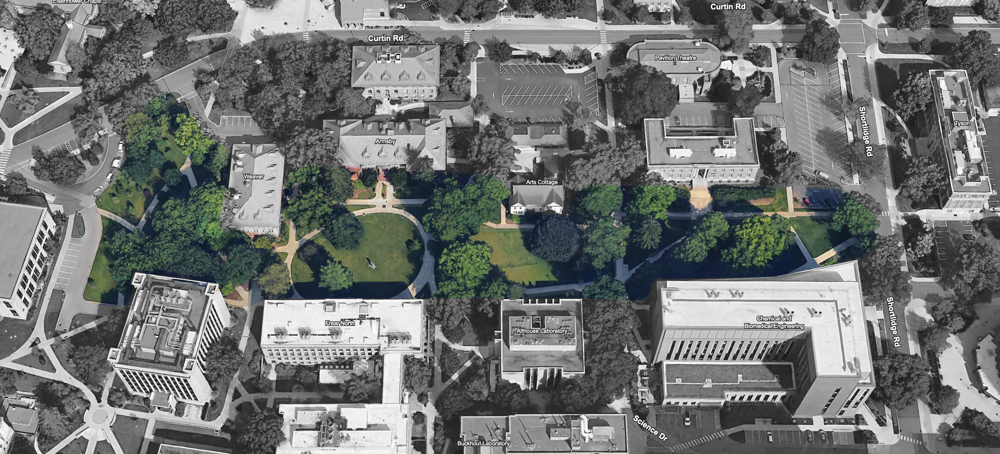

# Project Assignment Statement (semester-long phased project)

## Overview
Design an ecologically appropriate planting design for Penn State’s Shortlidge to Paterno Library Pedestrian Mall (@fig-project_statement_site: a high-visibility, high-traffic campus corridor) that achieves **net biodiversity gain through ecological function**, not aesthetics. Your design must:

- Prioritize **plant–insect–pollinator–bird interactions** across all life cycles (i.e., nesting, foraging, water access).
- Ensure **long-term resilience** via site-appropriate plant communities (using site analysis data).
- Be **client-ready** for SLIP donor fundraising (accessible to non-specialists; e.g., donors, campus sustainability, OPP).
- **Explicitly align** with ASLA’s Climate & Biodiversity Action Plan (2026–2030) and Penn State’s SLIP.

{#fig-project_statement_site fig-alt="An aerial map of a campus section of Penn State showing Curtin Road to the north and Shortlidge Road to the east. The map uses a selective color effect: the surrounding buildings and roads are in grayscale, while a central horizontal swath of landscaping is highlighted in full color. This green corridor features large lawns, mature trees, and curved walkways, and is situated south of the Weaver, Armsby, and Arts Cottage buildings, and north of the Frear North, Althouse Laboratory, and Chemical and Biomedical Engineering buildings." fig-align="center" width=100%}

{#fig-site_8 fig-alt="View from the sidewalk at the Paterno Library parking lot towards Mueller Lab and Weaver Building. Campus landscape with a broad mown lawn shaded by mature trees. A curved concrete sidewalk, bordered by black posts and chains, crosses the foreground and loops toward a road with parked cars and nearby buildings." fig-align="center" width=100%}

{#fig-site_15 fig-alt="A campus walkway curves through a mature, tree-shaded lawn and branches toward a large building on the right. Bare soil surrounds several tree trunks, while a small rock feature sits beside the paved plaza. Part of a bicycle is visible in the lower-left corner." fig-align="center" width=100%}

{#fig-site_18 fig-alt="A shaded campus walkway curves through a broad mown lawn beneath mature trees, with a metal bench beside the path and black chain-linked posts bordering the grass. Brick and modern academic buildings frame the open space." fig-align="center" width=100%}

{#fig-site_28 fig-alt="A landscaped campus courtyard with broad concrete steps and a black handrail in the foreground. Walkways fork around a small lawn with a young tree, bordered by mature evergreens and deciduous trees, ornamental grasses, and chain-linked posts. A person walks along the left path." fig-align="center" width=100%}

{#fig-site_36 fig-alt="A paved brick campus plaza beneath a sweeping building canopy, with a circular wooden bench around a planted opening. Paths lead across a lawn toward mature trees and nearby buildings; a raised planting bed and roadside sit to the right, with a few people in the distance." fig-align="center" width=100%}

## Point Value
150 points

## Deliverables
All deliverables must include ecological justification, client-facing visuals, and technical documentation.

### Due Dates
Note: Due dates are documented within the [course schedule](02_schedule.qmd). 

### Phase I: Pollinator and Bird Life Cycle Mapping
**Task**: As a class we will develop templates for the fact cards. You will use physical fact cards + colored strings to map connections (nesting, foraging, water) across the life cycle of birds and pollinators. For pollinators you must insure you are mapping to all three life cycles. Integrate guest lecture insights.

**Final Deliverable**: Annotated physical food web + 1-page analysis of potential ecological gaps (e.g., "No cavity-nesting bees in current site"). 

{#fig-plant_fact_card_a4_1 fig-alt="Front of a plant identification card for Common Milkweed (Asclepias syriaca). The card features a close-up photograph of the plant's dense, spherical umbel of intricate pink and white flowers set against large, broad green leaves. Below the image, design and ecological specifications are detailed: Plant type is listed as Herbaceous Flower (Forb). A row of ecological value icons indicates it supports caterpillars, beneficial insects, bees, and birds, and that it is deer-resistant. A bloom phenology chart shows active blooming during the months of June, July, and August. Text at the bottom notes it attracts bees, butterflies, pollinators, songbirds, and specialized bees, and serves as a larval host for the Monarch Butterfly (Danaus plexippus) and Milkweed Tiger Moth (Euchaetes egle)." fig-align="center" width=100%}

{#fig-plant_fact_card_a4_2 fig-alt="Back of the plant identification card for Common Milkweed (Asclepias syriaca), detailing technical specifications for landscape design. The Attributes section lists a height of 3 feet to 5 feet and a width of 8 inches to 1 foot. 
Under Growing Conditions, it specifies USDA Hardiness Zones 3a to 9b, full sun light requirements, and moist soil. It accepts a wide range of soil textures including clay, loam (silt), sand, and shallow rocky soils, with a pH range of 4.8 to 6.8. The Landscape section notes it tolerates deer, drought, dry soil, erosion, and poor soil. It is recommended for naturalized areas and fits themes such as butterfly, native, and pollinator gardens. Its Play Value includes attractive flowers, ease of growth, fragrance, and serving as a wildlife food source and larval host. Problems to note are that it is weedy and poisonous to humans, cats, dogs, and horses.  Finally, an Aesthetic Phenology chart indicates active blooming in June, July, and August, with no significant fall color or bark interest shown for any month." fig-align="center" width=100%}

{#fig-plant_fact_card_a4_3 fig-alt="Front of a species identification card for the Monarch butterfly (Danaus plexippus). The top half features three photographs illustrating its life stages: a caterpillar with distinct black, white, and yellow stripes on a green leaf; an adult butterfly with vibrant orange and black wings dotted with white, feeding on white flowers; and a smooth, bright green chrysalis hanging from a leaf. Below the images, the 'Type' is identified as Butterfly. The 'Habitat' section states it utilizes many open habitats including fields, meadows, weedy areas, marshes, and roadsides. The 'Life Cycle' section details that adults warm up by basking dorsally with wings open toward the sun, and females lay eggs singly under host leaves, which the caterpillars then eat along with the flowers. It also notes their massive migrations from August to October, flying thousands of miles to hibernate along the California coast and in central Mexico, stopping along the way to feed on flower nectar and roost together at night." fig-align="center" width=100%}

{#fig-plant_fact_card_a4_4 fig-alt="Back of the species identification card for the Monarch butterfly (Danaus plexippus), detailing ecological requirements for landscape planning.  The 'Foraging' section lists caterpillar hosts as milkweeds, specifically noting common milkweed (Asclepias syriaca), swamp milkweed (A. incarnata), and showy milkweed (A. speciosa), as well as milkweed vine in the tropics. For adult hosts, it notes they rely on nectar from all milkweeds, but also require early-season flowers like dogbane, lilac, red clover, lantana, and thistles before milkweeds bloom. In the fall, adults visit composites including goldenrods, blazing stars, ironweed, and tickseed sunflower. The 'Nesting' section is marked as not applicable. Under 'Water Needs', a critical design constraint is noted: butterflies cannot land directly on deep open water like birdbaths or ponds to drink safely. Instead, they require damp mud, wet sand, or dew to extract vital salts and minerals. Finally, the 'Management Needs' section advises minimizing or eliminating pesticides and herbicides, and providing a diversity of nectar sources." fig-align="center" width=100%}

{#fig-plant_fact_card_a4_5 fig-alt="Front of a species identification card for the Brown Belted Bumblebee (Bombus griseocollis). The card features a close-up photograph of the fuzzy, yellow and black bee foraging on the prominent orange and brown central cone of a pink coneflower. Below the image, the 'Type' is identified as Bee. The 'Habitat' section highlights its high adaptability for various site conditions, noting it can occupy meadows, wetlands, agricultural fields, and urban areas, including densely populated cities. The 'Life Cycle' section provides seasonal activity data, stating that queens emerge in late spring with peak worker numbers occurring in July, and that new queens and drones are present from late June to September." fig-align="center" width=100%}

{#fig-plant_fact_card_a4_6 fig-alt="Back of the species identification card for the Brown Belted Bumblebee (Bombus griseocollis), outlining specific habitat and management requirements for landscape design. Under 'Foraging', caterpillar hosts are marked as not applicable. For adult hosts, it lists a wide variety of wildflowers from the sunflower, milkweed, pea, and mint families, specifically recommending coneflowers, black-eyed Susans, goldenrods, milkweeds, clovers, bush clovers, vetches, beebalm, wild bergamot, and horsemint. The 'Nesting' section notes they typically nest underground in abandoned rodent burrows, or on the surface in dense grass, compost piles, or thick leaf litter. 'Water Needs' indicates they generally do not require a dedicated standing water source. The 'Management Needs' section specifies they are 'short-tongued' bees that prefer shallow, open flowers. Crucial site management directives include retaining undisturbed bunchgrasses, rock piles, downed logs, and woody debris; leaving empty spaces beneath low-growing shrubs for shelter; eliminating pesticide and herbicide use; and retaining fallen leaves by avoiding leaf blowing." fig-align="center" width=100%}

**Rubric**: 

*Total: 30 points* 

| Criterion | A — 5 points | B — 4 points | C — 3 points | D — 2 points | F — 0–1 point |
|---|---|---|---|---|---|
| **1. Life-cycle coverage** | Maps birds across relevant life-cycle needs and maps pollinators across **all three life cycles**, with connections represented at each relevant stage. | Covers nearly all relevant bird needs and all three pollinator life cycles; one minor stage or connection is underdeveloped. | Includes birds and pollinators, but one pollinator life cycle or several relevant stages are incomplete or unclear. | Major omissions in bird or pollinator life-cycle coverage; fewer than all three pollinator life cycles are meaningfully mapped. | Life-cycle mapping is largely absent, unusable, or missing either birds or pollinators. |
| **2. Ecological connections: nesting, foraging, and water** | Clearly maps and labels nesting, foraging, and water relationships with colored strings; links are ecologically meaningful and easy to follow. | Represents all three connection types; most links are meaningful and traceable, with minor ambiguity. | Represents at least two connection types or includes all three with several unclear or weak links. | Connections are sparse, difficult to trace, or substantially misrepresent ecological relationships. | Connections are absent or not interpretable. |
| **3. Fact-card use and food-web annotations** | Uses the class fact-card template consistently; annotations identify organisms/resources and explain the mapped relationships accurately. | Cards and annotations are mostly complete and accurate, with minor missing details. | Cards or annotations are uneven; some relationships lack explanation or supporting information. | Many cards or annotations are incomplete, inaccurate, or disconnected from the mapped web. | Fact cards or useful annotations are largely missing. |
| **4. Integration of guest lecture insights** | Explicitly and accurately applies relevant guest lecture insights to explain or strengthen multiple food-web connections. | Applies at least one relevant insight accurately and connects it to the web. | Mentions a relevant insight, but its application to the mapped relationships is limited or unclear. | Guest lecture insight is only vaguely referenced or is not meaningfully connected to the work. | No relevant guest lecture insight is incorporated. |
| **5. One-page ecological gaps analysis** | Provides a focused one-page analysis that identifies specific ecological gaps, supports them with evidence from the food web, and explains which life-cycle needs or relationships are affected. | Identifies specific gaps and generally connects them to evidence in the web; analysis is mostly complete. | Identifies at least one plausible gap, but evidence or explanation of ecological consequences is limited. | Gaps are vague, weakly supported, or not clearly tied to the food web. | Analysis is missing or does not identify an ecological gap. |
| **6. Deliverable completeness and legibility** | Submits both required deliverables—the annotated physical food web and one-page analysis—and both are organized, legible, and usable for review. | Both deliverables are present and legible, with minor organizational or completeness issues. | Both are present, but one is difficult to interpret or has notable omissions. | One deliverable is substantially incomplete or difficult to review. | One or both required deliverables are missing or unusable. |

*Final letter grade*

| Total points | Letter grade |
|---:|:---:|
| 27–30 | A |
| 24–26 | B |
| 21–23 | C |
| 18–20 | D |
| 0–17 | F |

### Phase II: Site Inventory & Analysis
**Task**: As a class we will complete a site analysis on the topics shown in @tbl-ia_checklist. Each student will sign-up for 2-3 of the following topics.

| Category                       | Resources                                      |
|:-------------------------------|:-----------------------------------------------|
| ***Biophysical***              |                                                |
| *Topography*                   |                                                |
| Slope                          |                                                |
| Elevation                      |                                                |
| Orientation (aspect)           |                                                |
| *Drainage*                     |                                                |
| HP and LP                      |                                                |
| Pattern and flow direction     |                                                |
| Off-site flow (watershed context)|                                              |
| *Microclimate*                 |                                                |
| Sun/shade                      |                                                |
| Prevailing winds               | <a href="https://mesonet.agron.iastate.edu/sites/dyn_windrose.phtml?station=UNV&network=PA_ASOS&bin0=2&bin1=5&bin2=7&bin3=10&bin4=15&bin5=20&conv=from&units=mph&nsector=36&fmt=png&dpi=100&year1=2023&month1=1&day1=1&hour1=0&minute1=0&year2=2023&month2=8&day2=23&hour2=0&minute2=0" target="_blank">Windroses</a> |
| Microclimate wind effects      | <a href="https://www.youtube.com/watch?v=xU7i4FcLS_E" target="_blank">Windflow and Venturi effect video</a> |
| Site-specific microclimate     |                                                |
| *Soil Type and conditions*     |                                                |
| Soil texture                   | <a href="https://www.youtube.com/watch?v=ahY5qZwaY1E" target="_blank">Soil texture feel text video</a> |
| Soil texture PDF               | <a href="https://tflohr.com/wp-content/uploads/2024/08/PM_Soil_texture_by_feel.pdf" target="_blank">Soil texture PDF</a> |
| Soil compaction                | <a href="https://tflohr.com/wp-content/uploads/2024/08/PM_Penetrometer_article.pdf" target="_blank">Soil penetrometer  instructions</a> |
| USDA web soil survey           | <a href="https://websoilsurvey.nrcs.usda.gov/app/WebSoilSurvey.aspx" target="_blank">Web soil survey</a> |
| *Vegetation, veg. condition*   |                                                |
| *Habitat*                      |                                                |
| Types                          |                                                |
| Condition                      |                                                |
| Species                        |                                                |
| *Local Context*                |                                                |
| Vegetation                     |                                                |
| Penn State Trees               | <a href="https://psu-opp.maps.arcgis.com/apps/webappviewer/index.html?id=accaa2c563cb4141b76c7c76c7dec370" target="_blank">Trees of Penn State</a> | 
| 
| Habitat and possible wildlife  | <a href="https://www.google.com/url?sa=t&rct=j&q=&esrc=s&source=web&cd=&ved=2ahUKEwjwgI-xn_WAAxVPmGoFHSxJBLkQFnoECBEQAQ&url=https%3A%2F%2Fwww.naturalheritage.state.pa.us%2Fcnai_pdfs%2Fcentre%2520county%2520nhi%25202002-web.pdf&usg=AOvVaw0wrPNmgfdnho2I9NY6sQY-&opi=89978449" target="_blank">Centre County Natural Heritage Inventory, 2002</a> |
| Ecological concepts  | <a href="https://tflohr.com/wp-content/uploads/2024/08/PM_landscape_ecology_principles.pdf" target="_blank">Landscape Ecology Principals</a> |
| PA Pollinators  | <a href="https://pollinators.psu.edu/pennsylvanias-pollinators" target="_blank">Pollinators of PA references</a> |
|***Sensory Qualities & Spatial Impacts*** |                                      |
| Spatial volumes, masses, enclosures, nested spaces; compression & release; spatial ‘leakage’|         |
| Views, noise, odors, textures, colors (include views from buildings)|           |
| “Gestalt” (feel) of the site as a place |                                       |
| Cultural/Infrastructural       |                                                |
| *Uses*                         |                                                |
| Type: On-site                  |                                                |
| Type: Off-site / nearby        |                                                |
| Current / historic             |                                                |
| *Architecture & Structures*    |                                                |
| Interior Activities/Programs   |                                                |
| Form                           |                                                |
| Materials                      |                                                |
| Height                         |                                                |
| Orientation                    |                                                |
| Exterior walls, stairs, terraces, views |                                       |
| Rooftops/green roofs           |                                                |
| *Vehicular Circulation (Including bikes)* |                                     |
| Routes                         |                                                |
| Hierarchy and volume           |                                                |
| Entry/exit                     |                                                |
| Intersections                  |                                                |
| Parking                        |                                                |
| *Pedestrian Circulation*       |                                                |
| Routes                         |                                                |
| Hierarchy and volume           |                                                |
| Entry/exit                     |                                                |
| Intersections                  |                                                |
| Materials                      |                                                |
| *Utilities*                    |                                                |
| Lighting; overhead lines       |                                                |
| Storm Drains (pipes, inlets, etc.) |                                            |
| Steam line?                    |                                                |
| Below-ground stormwater reservoir |                                             |
| other                          |                                                |

: Inventory and analyses checklist. {#tbl-ia_checklist}

**Final Deliverable**: A powerpoint presentation to your peers. Each person will give a 5-10 minute overview, of just the highlights of their topics.

**Rubric**: 

*Total: 20 points*

| Criterion | A — 4 pts | B — 3 pts | C — 2 pts | D — 1 pt | F — 0 pts |
|---|---|---|---|---|---|
| **1. Assigned topic coverage and site specificity** | Thoroughly addresses all 2–3 assigned topics and relevant subtopics; findings are accurate and clearly specific to the site. | Addresses assigned topics with minor omissions; findings are mostly accurate and site-specific. | Covers main points, but has notable omissions, limited site specificity, or uneven accuracy. | Major gaps; findings are vague, weakly connected to the site, or frequently questionable. | Little relevant, accurate coverage of assigned topics. |
| **2. Analysis and interpretation** | Clearly explains what findings mean for site function and experience; identifies important patterns, constraints, opportunities, or relationships. | Provides sound interpretation and relevant implications, with some connections among findings. | Includes basic interpretation but relies mostly on description or makes few connections. | Analysis is minimal, unclear, or largely descriptive. | No meaningful analysis or interpretation. |
| **3. Evidence and use of resources** | Supports findings with appropriate observations, mapping, measurements, or sources; clearly distinguishes observed, sourced, and inferred information. | Uses appropriate evidence and identifies most sources; minor support or attribution gaps. | Includes some evidence and sources, but support or attribution is inconsistent. | Uses little reliable evidence; sources are unclear or weakly connected to claims. | Claims lack usable evidence or sources. |
| **4. PowerPoint organization and visual communication** | Slides are concise, legible, logically organized, and use effective visuals to clarify findings. | Slides are clear and organized; visuals generally support the content. | Main points are communicated, but organization, legibility, or visuals have noticeable issues. | Slides are difficult to follow, overly text-heavy, or use visuals that provide little support. | Slides are missing or do not communicate the findings. |
| **5. Peer presentation and timing** | Presents focused highlights clearly, explains key visuals and findings, and stays within 5–10 minutes. | Communicates highlights clearly and is close to the time range. | Understandable but uneven, too detailed or brief, or notably outside the time range. | Difficult to follow, poorly focused, or substantially outside the time range. | Presentation is not delivered or does not meaningfully address the assigned work. |

*Final letter grade*

| Total points | Letter grade |
|---:|:---:|
| 18–20 | A |
| 16–17 | B |
| 14–15 | C |
| 12–13 | D |
| 0–11 | F |

### Phase III: Conceptual Design
**Task**: Develop two distinct concepts (e.g., Native Meadow vs. Seasonal Forest Edge) for two adjacent sub-areas within our project with: 

- Spatial drawings (plans, seasonal sections, perspectives)
- Illustrative food webs 
- Phenological plant lists (seasonal bloom cycles) 

::: {.callout-tip}
## Reminder

During the conceptual design process, you will create a wide range of plan, section-elevation, perspective, and plant form graphics that may or may not make it into the final deliverables. This is the sign of a great iterative process that refines your ideas deeply.
::: 

**Final Deliverables**: Public poster review that presents the following:

- Two or three, 36" x 48" posters containing:
    + A unique concept statement for each concept
    + A plan for each concept
    + Seasonal section-elevation for each concept
    + Perspectives for each concept
    + Illustrative food webs for each concept
    + Phenological plant lists for each concept
- 10 minute presentation to faculty/professionals/stakeholders (approx. 5 minutes per concept - **highlights only**)

Note: One of the concepts should aggressively challenge the standard campus landscape and the other more directly align with OPP's current landscape efforts. 

{#fig-oceania_planting_1 fig-alt="A two-page spread from a design document titled 'Oceania Planting Scheme,' detailing the plant selection strategy and categorization symbology. The left page, titled 'Selection Strategy,' divides applications into two main spatial categories with corresponding blue icons: 01 Vertical Planting (including green walls, climbing features, and hanging plants) and 02 Horizontal Planting (including planters, in-grade, and street/plaza planting). Below this, 03 Solar Exposure is defined using sun and cloud icons to represent Sun, Part Sun/Part Shade, and Full Shade. The right page explains further categorizations. Section [4] Water introduces a visual 1 to 5 water droplet scale used on plant tags to define the minimum and maximum water a plant can handle. An example shows a solid droplet indicating the minimum water required to survive, and an open dark droplet indicating the maximum level it can tolerate. A blue sidebar explicitly defines this 1 to 5 scale: 1 is low water use/drought tolerant; 2 handles typical irrigation in well-drained soils; 3 is moderate frequency/quantity; 4 is high frequency/quantity; and 5 requires constant saturation. Finally, section 5 Seasonal Showcase explains how seasonal bloom and color interest are displayed, using specific icons for 'Flowering Plants' and 'Foliage Color Interest' mapped to a 12-month timeline (Jan-Dec) with colored dots that indicate the specific feature color and time of year." fig-align="center" width=100%}

{#fig-oceania_planting_2 fig-alt="A two-page landscape design document spread illustrating seasonal phenology and color interest. The left page features a large 'Horizontal Planting' Gantt-style chart that maps the seasonal highlights of flowers and foliage across a 12-month timeline, with months labeled in Spanish (Enero to Diciem). Each row represents a specific plant species, identified by a two- or three-letter abbreviation. The duration of seasonal interest is marked by horizontal bars that are color-coded to match the plant's actual bloom or prominent foliage color, creating a cascading visual spectrum from pinks and reds down to blues, purples, and whites. A footnote indicates that solid lines represent continuous interest, while dotted lines denote intermittent flowering throughout the defined time. The right side of the spread, titled 'Seasonal Interest' on a bright pink background, includes conceptual text and a quote from fashion designer Isaac Mizrahi emphasizing the emotional impact of color. This is accompanied by five abstract icons and four vibrant reference photographs of plants showcasing distinct seasonal colors and textures: a mass of bright pink blooms, a patch of fine-textured chartreuse foliage, vibrant orange lilies, and pink flowers set against dark purple foliage." fig-align="center" width=100%}

{#fig-hoerrschaudt_seasonal_planting fig-alt="A graphic illustrating seasonal planting succession and visual interest for an urban rooftop park. The top half displays a sequence of four identical plan-view diagrams of a geometrically patterned planting bed, representing the progression of the four seasons. Surrounding each plan are circular callouts containing reference photos and lists of scientific names (including cultivars) to highlight the specific plant combinations active during that period. For example, Spring callouts feature Veronica and Nepeta; Summer highlights Echinacea and Agastache; Fall emphasizes ornamental grasses like Panicum and Calamagrostis; and Winter focuses on the persistent structure of dormant grasses and perennials. The bottom half features four corresponding photographs of the built project, labeled Spring, Summer, Fall, and Winter, set against a dense city skyline. These site photos demonstrate the real-world visual progression of the planting design: vibrant blue and purple blooms dominating in Spring; lush greens with pink and purple accents in Summer; a transition to golden, textural ornamental grasses in Fall; and the retention of structural form and volume using dormant, tan, and brown foliage in Winter." fig-align="center" width=100%}

{#fig-LI_01 fig-alt="A circular phenology diagram by Landscape Interactions titled 'Seasonal bloom diagram of the Habit to Habitat design with pollinator species supported based on flight time.' The core graphic is a radial calendar divided into the four seasons and twelve months. Concentric colored arcs map the specific bloom duration and flower color for a list of plant species arranged radially along the left axis. A photorealistic collage of trees, shrubs, and herbaceous plants wraps around the top and right perimeter of the circle, visualizing the mature plant palette in bloom, highlighted by a large pink flowering tree at the top. To the right, a text section titled 'Pollinator Flight Times' categorizes specific bee and butterfly species into All Season, Early Season, Mid Season, and Late Season fliers. This section lists specific active date ranges (e.g., Mar-Oct, Apr-Jun) alongside the insect names. Faint leader lines connect these pollinator flight periods back to the corresponding plant bloom arcs in the central circle, effectively illustrating how the planting design provides continuous ecological support and forage throughout the year." fig-align="center" width=100%}

{#fig-LI_02 fig-alt="An educational matrix by Landscape Interactions illustrating six distinct green infrastructure and planting typologies, arranged in a two-row by three-column grid. Each typology features a perspective illustration demonstrating its spatial context and function, followed by three columns detailing its Ecological, Economic, and Cultural benefits. The top row focuses on stormwater management strategies: Rain Garden: Described as capturing stormwater where it falls. The illustration shows a residential yard where a downspout directs runoff into a depressed, planted basin. Blue dashed arrows illustrate water flowing into the basin and infiltrating down into the soil. Bioswale: Described as conveying and treating stormwater. The illustration shows a linear planted channel situated between a roadway and a multi-use path. Blue dashed arrows indicate water flowing longitudinally down the swale and infiltrating the ground. Riparian Buffer: Described as protecting waterways and stabilizing banks. The illustration depicts a densely vegetated river edge with a walking path. Blue dashed arrows show subsurface groundwater being filtered through the root zones before entering the stream. The bottom row focuses on vegetation and land management strategies: Meadow: Described as supporting biodiversity and reducing maintenance. The illustration shows a broad, open expanse of diverse grasses and wildflowers with a mown pedestrian path winding through it. Windbreak: Described as slowing wind to protect people, crops, and infrastructure. The illustration shows a dense, multi-layered row of evergreen and deciduous trees sheltering a farmstead. Sweeping gray arrows visually demonstrate prevailing winds being deflected up and over the tree canopy. Hedgerow: Described as forming living boundaries for wildlife and livelihoods. The illustration shows a thick, linear planting of shrubs and trees integrated along a wooden fence line bordering a livestock pasture. Below each illustration, the standardized benefit columns provide specific bullet points. Generally, the 'Ecological Benefits' focus on biodiversity, soil health, and water quality; 'Economic Benefits' highlight reduced maintenance, lower infrastructure costs, and increased property value; and 'Cultural Benefits' emphasize aesthetics, sense of place, and educational or recreational opportunities." fig-align="center" width=100%}

{#fig-LI_03 fig-alt="A page from a Landscape Interactions design document titled 'At-Risk Pollinators Supported by This Plan,' illustrating a method for communicating a project's ecological value. The center of the page features a dense, two-column table listing specific at-risk 'Bees', providing both the scientific and common names for dozens of species (e.g., Bombus fervidus, Golden Northern Bumble Bee).Surrounding the text block are five circular macro photographs showing various insects interacting with native flora, including a bumblebee on a pink Monarda, a caterpillar, a butterfly on orange Asclepias, a green hairstreak butterfly, and a crab spider with a moth. These circular image callouts are linked by thin, overlapping colored lines that sweep across the page, creating a dynamic graphic frame. In the bottom right corner, a bold infographic summarizes the project's conservation impact. It uses repeating pictograms of bees, butterflies, and moths alongside large text to state that the plan supports '49 Bee Species, 34 Butterfly Species, [and] 43 Moth Species At Risk of Local Extinction." fig-align="center" width=100%}

**Rubric**: 

*Total: 60 points*

| Criterion  | **A** | **B** | **C** | **D** | **F** |
|---|---|---|---|---|---|
| **1. Distinct concepts and concept statements (8 pts)** | Presents two clearly distinct concepts for the adjacent sub-areas. One boldly challenges standard campus landscapes; the other clearly aligns with OPP’s current landscape efforts. Each has a concise, compelling, unique concept statement. | Concepts are distinct and meet the required contrasting directions; statements communicate each concept with minor gaps. | Concepts or statements are understandable but insufficiently differentiated, specific, or connected to the required contrast. | Concepts are weakly differentiated or one required direction is unclear; statements are vague or incomplete. | Two concepts and usable concept statements are absent, or neither concept addresses the required contrast. |
| **2. Concept plans (8 pts)** | Provides a clear, well-resolved plan for each concept; plans communicate spatial organization, planting intent, and relationships to the adjacent sub-areas. | Complete, legible plans for both concepts with minor gaps in clarity or resolution. | Plans are present but have noticeable gaps, uneven detail, or unclear spatial relationships. | One plan is substantially incomplete or both are difficult to interpret. | Plans are missing or do not communicate the concepts. |
| **3. Seasonal section-elevations (8 pts)** | Includes a clear seasonal section-elevation for each concept; effectively communicates spatial form, planting structure, and meaningful seasonal change. | Includes sections for both concepts that communicate form and seasonality, with minor omissions. | Sections are present but seasonal change, spatial experience, or planting structure is only partly clear. | One section is missing or the sections provide little useful seasonal or spatial information. | Seasonal section-elevations are missing or unusable. |
| **4. Perspectives (7 pts)** | Perspectives for both concepts vividly and accurately communicate spatial experience, planting character, and the intended concept. | Both concepts have clear perspectives with minor gaps in detail or communication. | Perspectives are present but uneven, generic, or only partly connected to the concepts. | One concept lacks a perspective, or the images are difficult to understand. | Perspectives are missing or do not communicate either concept. |
| **5. Illustrative food webs (7 pts)** | Each concept has a clear, accurate illustrative food web showing meaningful ecological relationships and how the concept supports ecological function. | Food webs are included for both concepts and show relevant relationships, with minor gaps or inaccuracies. | Both are present, but connections or ecological function are limited, unclear, or unevenly supported. | A food web is missing or the webs show few interpretable ecological relationships. | Food webs are missing or substantially inaccurate. |
| **6. Phenological plant lists (7 pts)** | Each concept includes a well-organized, appropriate plant list that clearly shows seasonal bloom cycles and supports the concept’s ecological intent. | Complete lists for both concepts show seasonal bloom cycles, with minor omissions or clarity issues. | Lists are present, but seasonal coverage, organization, or connection to the concepts is incomplete. | A list is missing or seasonal bloom information is substantially limited. | Plant lists are missing or do not communicate phenology. |
| **7. Poster completeness and visual communication (7 pts)** | Two or three 36" × 48" posters are polished, legible, well organized, and integrate all required components for both concepts into a coherent presentation. | Posters include all required components and are generally clear and organized, with minor layout or legibility issues. | Most required content is present, but important omissions, crowding, or inconsistencies make comparison or comprehension harder. | Multiple required components are missing, or poster layout substantially impedes understanding. | Posters are missing or do not present the required work. |
| **8. Public review presentation (8 pts)** | Delivers a focused, engaging 10-minute presentation, allocating about five minutes to each concept; clearly explains highlights and supports comparison for the review audience. | Presents both concepts clearly and stays close to the time and balance expectations. | Communicates the main ideas, but timing, focus, balance, or explanation is uneven. | Presentation is difficult to follow, substantially mistimed, or gives little attention to one concept. | Presentation is not delivered or does not meaningfully explain the concepts. |

*Final letter grade*

| Total points (out of 60) | Letter grade |
|---:|:---:|
| 55.80–60.00 | A |
| 51.00–55.79 | B |
| 45.00–50.99 | C |
| 39.00–44.99 | D |
| 0–38.99 | F |

### Phase IV: Design Development and Construction Documentation
**Task**: Refine one concept into a single concept and a set of drawings that address the feedback received from Phase III presentations and desk crits. Also, create a construction planting plan and plant schedule that respects the necessary scale, communication, and temporal needs of the proposed design.

::: {.callout-tip}
## Reminder

During the design development and construction documentation process, you still create a wide range of plan, section-elevation, perspective, and plant form graphics that may or may not make it into the final deliverables. This signals a strong iterative process that refines your ideas deeply, rather than simply checking off reviewer comments, since there are likely multiple ways to address them.
::: 

**Final Deliverable**: 
-  Public PowerPoint (12 slides max: concept drawings, plant list, ecological metrics, client story) with a printed set of planting plans and plant schedule.
- Set of planting plans and plant schedules, with any required management notes.

{#fig-metro-forest_01 fig-alt="A fully rendered landscape masterplan in plan view, illustrating a highly vegetated, inward-focused park or ecological site. The rendering style utilizes photorealistic textures, drop shadows, and subtle white contour lines to effectively communicate topography, water depth, and dense canopy volume. The site is bordered by a public road to the west. The spatial organization is defined by a thick, continuous 'Forest Berm' (3) that encloses the perimeter, buffering the interior. The central core is dominated by a large, organically shaped 'Natural Pond' (12) featuring varied edge conditions, a 'Waterfall' (13), and a 'Weir' (14). Major programmatic and architectural elements include a linear 'Exhibition Building' (9) on the western edge. This structure is heavily integrated into the landscape, featuring an extensive 'Roof Garden' (10) that transitions into an 'Outdoor Theatre Lawn' (11) sloping toward the water. A dynamic circulation system includes a 'Skywalk' (16) that weaves through the tree canopy and crosses the pond, connecting to an 'Observation Tower' (17) situated on a peninsula. Numbered circular callouts are distributed across the plan, corresponding to a 21-item legend on the right side that identifies entrances, circulation routes, ecological features, and a 'Plant Nursery' (21) in the northeast corner. Standard graphic conventions, including a North arrow pointing up and a metric graphic scale bar (0, 5, 15, 30 m), are located in the bottom right corner." fig-align="center" width=100%}

{#fig-metro-forest_02 fig-alt="An axonometric diagram titled 'FOREST TYPOLOGIES' illustrating the spatial distribution of distinct plant communities across a designed landscape. The rendering uses soft textures to depict a central undulating water body surrounded by constructed berms, creating varied topographic conditions. Blue dashed arrows are mapped across the terrain, indicating surface water runoff patterns flowing from the elevated perimeter down into the central aquatic zones. A legend identifies ten specific planting zones corresponding to numbered callouts on the plan: (1) Lowland Dipterocarp Forest dominating the outer berms, (2) Mixed Deciduous Forest, (3) Limestone Vegetation, (4) Brackish Water Vegetation along the water's edge, (5) Aquatic Plant zones within the pond, (6) Beach Vegetation, (7) Bamboo Collection, (8) Banana Collection, (9) Palm Collection, and (10) a Roof Garden situated atop a linear building integrated into the landscape's slope. Architectural elements, including an observation tower and a winding elevated boardwalk, demonstrate how pedestrian circulation is woven through the diverse ecological zones." fig-align="center" width=100%}

{#fig-metro-forest_03 fig-alt="A chronological growth diagram titled 'LOWLAND DIPTEROCARP FOREST,' illustrating the temporal succession and vertical stratification of a planting palette over a 30-year period. The graphic uses paired 3D axonometric site chunks (top row) and 2D section-elevations (bottom row) across four stages: 'After planting', '3 Year', '10 Year', and '30 Year'. The top row of axonometric models shows a sloped terrain intersected by an elevated, zig-zagging pedestrian boardwalk. These models visually demonstrate the spatial experience changing over time, transitioning from an exposed structure surrounded by sparse saplings to a boardwalk completely immersed within a dense,mature forest canopy.The bottom row of section-elevations plots this growth against a vertical scale ranging from 0m to 40m. Below the section lines, specific plant species are identified by structural codes (T1 for canopy trees, T2 for understory trees, S for shrubs, H for herbs) and scientific names, including Dipterocarpus alatus, Syzygium cumini, Murraya paniculata, Hopea odorata, Streblus asper, and Amomum villosum. The sections clearly quantify the growth rate and canopy layering: 'After planting' vegetation is under 5m; at '10 Year', the mid-canopy reaches 20m and begins to enclose the boardwalk; and by '30 Year', emergent canopy species exceed 35m, illustrating a complex, multi-tiered forest structure." fig-align="center" width=100%}

{#fig-metro-forest_04 fig-alt="A rendered section-elevation diagram titled 'HYDROLOGICAL MANAGEMENT,' illustrating the site's stormwater strategy. The graphic depicts a dense, multi-layered forest canopy situated on undulating topography, featuring elevated berms on the periphery and a central depressed wetland or pond system. Blue dashed arrows descending from clouds represent precipitation falling across the site. Within the central water bodies, white dashed arrows point downward and outward to illustrate surface water infiltrating the soil and recharging the groundwater. On the right side, an architectural structure is integrated into the berm, featuring a green roof. A blue subsurface cistern is located beneath the building, with dashed lines indicating it captures runoff from the roof and is connected to the central water body for water management. A cutaway of the earth reveals the engineered soil profile, labeled in a small legend on the far right: a dark top layer of 'Planting Soil Mix,' a middle layer of 'Backfill Clay Soil,' and a deep bottom layer of 'Existing Subgrade.' Small human figures are placed along the ground plane to provide a sense of scale." fig-align="center" width=100%}

{#fig-cd_branleymichaelpatrick fig-alt="A landscape architecture construction document, specifically a planting plan (Sheet L-101) for the Millennium Science Complex at University Park, PA, dated 9/27/2023 by M.Branley Landscape Architects. The central and right portions of the sheet display a plan-view line drawing of a planting layout. The design utilizes standard drafting conventions: large circular symbols with center crosshairs denote proposed trees, scalloped and clustered outlines represent shrub masses, and expansive, organic boundaries indicate herbaceous planting beds. Leader lines connect these symbols to callouts specifying quantities and two-letter plant abbreviations (e.g., '(1) AC', '(3) SR') or specific multi-species mixes (e.g., 'Mix 1: (15) PV, (10) SC'). The bottom left corner contains two data tables. The top table, 'Herbaceous Perennial Mixes,' details five distinct planting mixes, providing the plant key, scientific and common names, percent cover, and installation remarks for each species within a mix. Below it is a comprehensive 'Plant Schedule' categorized into Trees, Shrubs, Herbaceous Perennials, and Graminoids. This schedule includes columns for the plant key, total quantity, scientific name, common name, installation size, condition (e.g., B&B, container), and specific remarks. The right edge features a standard title block containing a blank 'General Notes' section, project and firm information, a scale noted as 1/4 inch = 1 foot 0 inches, and a North arrow pointing toward the top of the page." fig-align="center" width=100%}

**Rubric**: 

*Total: 40 points*

| Criterion | **A** | **B** | **C** | **D** | **F** |
|---|---|---|---|---|---|
| **1. Response to feedback and design refinement** | Clearly synthesizes relevant Phase III and desk-crit feedback into thoughtful design decisions; demonstrates meaningful iteration rather than literal or superficial comment-checking. | Addresses the main feedback through clear revisions, with minor missed opportunities or limited explanation. | Responds to some feedback, but revisions or their rationale are uneven or only partly developed. | Makes few meaningful revisions or responds to feedback without resolving key issues. | No discernible response to feedback; design remains unresolved or substantially unchanged where revision was needed. |
| **2. Concept coherence and spatial communication** | Refined concept is clear and consistently expressed through coordinated drawings that communicate spatial organization, experience, and planting intent. | Concept and drawings are coherent overall, with minor inconsistencies or communication gaps. | Concept is understandable, but drawings communicate it unevenly or leave important spatial relationships unclear. | Concept is difficult to follow; drawings are incomplete, inconsistent, or poorly connected to the design intent. | A coherent refined concept and supporting drawings are absent. |
| **3. Ecological performance and metrics** | Ecological metrics are relevant, clearly presented, and credibly connected to the proposed planting design; explains how the design supports ecological function over time. | Metrics and ecological rationale are generally relevant and connected to the design, with limited gaps in clarity or support. | Includes some useful metrics or ecological explanation, but relevance, interpretation, or design connection is limited. | Metrics are vague, weakly supported, or largely disconnected from the planting proposal. | Ecological metrics and a credible ecological rationale are absent. |
| **4. Construction planting plan: technical completeness and scale** | Planting plans use an appropriate, stated scale and provide precise, legible, coordinated information sufficient to locate and communicate the proposed planting. | Plans are mostly complete and scaled appropriately, with minor omissions or coordination issues. | Plans communicate the general layout but have notable gaps in scale, labeling, dimensions, plant locations, or legibility. | Plans are difficult to use for locating or interpreting planting; major technical information is missing. | Planting plans are missing or not usable. |
| **5. Plant schedule and temporal suitability** | Schedule is complete and coordinated with the plans; plant selections, quantities, and relevant characteristics are clearly identified and support the design’s seasonal and temporal needs. | Schedule is generally complete and coordinated, with minor missing information or limited explanation of temporal needs. | Schedule is usable but has noticeable omissions, coordination errors, or weak consideration of seasonal/temporal performance. | Schedule is substantially incomplete or inconsistent with the plans; temporal needs are poorly addressed. | Plant schedule is missing or unusable. |
| **6. Management and implementation notes** | Includes clear, practical management notes where needed, addressing establishment and ongoing care in ways that support the design’s intended ecological function and development over time. | Notes address the main management needs and are generally practical, with minor omissions. | Some relevant notes are included, but important management needs or timing are unclear. | Notes are sparse, vague, or impractical; key management needs are overlooked. | Required management notes are absent or provide no usable guidance. |
| **7. Public PowerPoint and client story** | PowerPoint is within the 12-slide maximum, well edited, and presents a compelling, audience-appropriate client story integrating concept drawings, plant list, and ecological metrics. | Presentation meets the slide limit and communicates the required content clearly, with minor gaps in narrative or editing. | Presentation includes most required content but is uneven, crowded, or only loosely organized around a client story. | Presentation exceeds the limit or omits multiple required elements; communication is difficult to follow. | Presentation is missing or fails to communicate the proposal and required content. |
| **8. Printed set and cross-deliverable coordination** | Printed planting plans and schedule are complete, readable, and professionally organized; all deliverables agree in plant names, locations, quantities, and design intent. | Printed set is clear and mostly coordinated, with minor discrepancies or presentation issues. | Printed materials are present but have noticeable legibility, completeness, or coordination problems. | Printed set is difficult to use or contains major omissions and contradictions with the PowerPoint or schedules. | Printed plans and schedule are missing or unusable. |

*Final letter grade*

| Final grade | Total points (out of 40) |
|---|---:|
| **A** | 37.20–40.00 |
| **B** | 34.00–37.19 |
| **C** | 30.00–33.99 |
| **D** | 26.00–29.99 |
| **F** | 0–25.99 |

